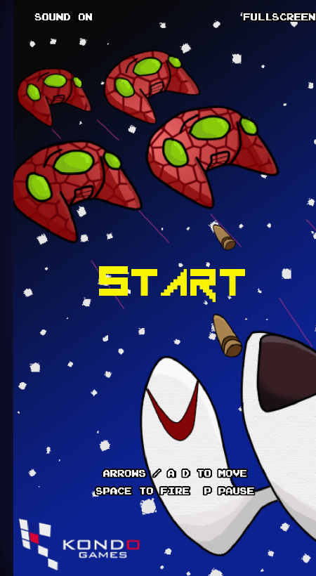
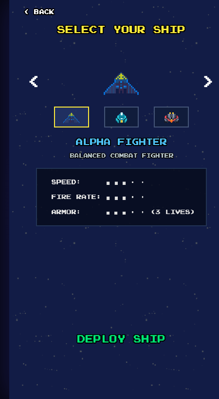
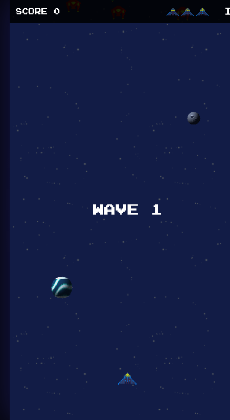

# Kondo Invaders

[](https://phaser.io/)
[-yellow.svg)](https://developer.mozilla.org/en-US/docs/Web/JavaScript)
[](LICENSE)
[](https://wwallass.github.io/kondo-invaders/)

Shoot 'em up arcade espacial estilo retro inspirado en los clásicos de los salones recreativos (*Space Invaders* y *Galaga*). Desarrollado para navegador web tanto en móviles como en escritorio con controles táctiles y por giroscopio.

🎮 **Jugar en vivo:** [https://wwallass.github.io/kondo-invaders/](https://wwallass.github.io/kondo-invaders/)

---

## 📸 Capturas de Pantalla

<p align="center">
  
  
  
</p>

---

## 🎬 Demostración y Video Gameplay

Puedes experimentar el juego en tiempo real directamente en tu navegador desde el enlace de producción o en local.

* **Demostración interactiva en vivo:** [https://wwallass.github.io/kondo-invaders/](https://wwallass.github.io/kondo-invaders/)
* En dispositivos móviles, añade el juego a tu pantalla de inicio mediante la opción **"Instalar aplicación"** o **"Añadir a la pantalla de inicio"** para jugarlo en pantalla completa como una Progressive Web App (PWA) nativa a 60 FPS fluidos.

---

## 🕹️ Cómo Jugar

Tu misión es sobrevivir a interminables oleadas de invasores alienígenas, esquivar sus patrones de proyectiles y ataques en picada, recoger mejoras tácticas y conseguir la máxima puntuación en la tabla de récords.

### Controles

| Acción | Escritorio | Móvil / Tablet |
| :--- | :--- | :--- |
| **Mover nave** | Teclas `←` `→` o `A` / `D` | **Inclinar el dispositivo (*Tilt Controls*)** |
| **Disparar** | Tecla `Espacio` (mantener = ráfaga automática) | Tocar la pantalla (mantener = ráfaga) |
| **Pausa** | Teclas `P` o `Esc` | Botón táctil `II` en la esquina superior |
| **Navegación en Menús** | Flechas / Enter / Espacio | Tocar botones en pantalla |

> **Nota sobre sensores móviles:** En navegadores móviles (iOS Safari / Android Chrome), los sensores de movimiento requieren un contexto seguro (HTTPS o `localhost`). En iOS, el juego solicita automáticamente autorización para usar el giroscopio con el primer toque.

---

## 🚀 Naves Seleccionables

Antes de cada misión, puedes elegir entre 3 cazas espaciales con atributos propios:

| Caza | Sprite | Velocidad | Cadencia | Vidas | Especialidad |
| :--- | :---: | :---: | :---: | :---: | :--- |
| **Alpha Fighter** | `player.png` | Media (320 px/s) | Estándar (285 ms) | 3 | **Equilibrada**: Rendimiento balanceado clásico. |
| **Phantom Dart** | `player-swift.png` | Muy alta (400 px/s) | Rápida (205 ms) | 2 | **Ágil y Rápida**: Ideal para jugadores con grandes reflejos. |
| **Titan Bastion** | `player-heavy.png` | Baja (250 px/s) | Pesada (380 ms) | 4 | **Blindaje Pesado**: Máxima resistencia y 4 vidas. |

---

## ⚡ Power-Ups Tácticos

Al eliminar alienígenas, existe la posibilidad de que suelten cápsulas con mejoras que descienden flotando:

| Power-Up | Ícono | Duración | Efecto |
| :--- | :---: | :---: | :--- |
| **Sombra Clon** | `powerup-shadow.png` | 10 segundos | Despliega un dron espectral detrás de tu nave que replica y **duplica todos tus disparos**. |
| **Disparo Triple** | `powerup-triple.png` | 10 segundos | Dispara ráfagas de **3 proyectiles simultáneos** en abanico. Se combina con la sombra para lanzar 6 disparos a la vez. |
| **Escudo de Energía** | `powerup-shield.png` | Hasta impacto | Crea un campo de fuerza que **absorbe por completo 1 golpe** (bala enemiga o colisión en picada). |
| **Bomba Inteligente** | `powerup-bomb.png` | Instantáneo *(Raro)* | Detona una onda electromagnética que **elimina a todos los enemigos en pantalla** y anula sus proyectiles. |

> **Regla de cambio de oleada:** Al superar cada oleada (*Wave*), se limpian de la pantalla todas las cápsulas no recogidas y se desactivan las mejoras temporales (*Sombra* y *Triple Disparo*). **El Escudo de Energía es la única mejora que se conserva entre oleadas** hasta que absorba un daño.

---

## 👾 Tipos de Invasores y Proyectiles

Cada enemigo tiene su propia personalidad, resistencia y proyectil personalizado:

| Enemigo | Apariencia | Salud | Puntos | Proyectil | Comportamiento |
| :--- | :---: | :---: | :---: | :--- | :--- |
| **Invasor Base** | Rojo / Ámbar | 1 | 20 | Bala giratoria | Enemigo de línea estándar en formación. |
| **Explorador** | Verde / Esmeralda | 1 | 30 | Aguja de plasma veloz (235 px/s) | Se lanza frecuentemente en picada suicida a gran velocidad. |
| **Élite** | Púrpura / Cian | 1 | 40 | Perno láser concentrado (195 px/s) | Francotirador con la cadencia de fuego más alta. |
| **Acorazado** | Azul / Acero | 2 | 60 | Orbe pesado de plasma (145 px/s) | Tanque blindado que requiere dos impactos para destruirse. |

> **Bonificación táctica:** Derribar a un invasor mientras realiza un ataque en picada otorga el **doble de puntos**.

---

## 🌌 Fondo Cósmico con Parallax Multicapa

El fondo del juego cuenta con un sistema de profundidad tridimensional con **5 capas independientes** que responden en tiempo real al movimiento e inclinación de la nave:

1. **Campo de Estrellas Infinito:** Capa base ultra-profunda con deriva constante y parallax horizontal suave.
2. **Luna / Planetoide (`planet-moon`):** Capa distante en escala de grises azulados.
3. **Planeta Helado (`planet-ice`):** Capa media-lejana con vórtices cian y esmeralda.
4. **Planeta Desértico (`planet-desert`):** Capa intermedia con dunas de óxido y cráteres terracota.
5. **Gigante Gaseoso (`planet-gas`):** Capa colosal en primer plano con bandas de nubes y sistema de anillos elípticos.

---

## 🛠️ Tecnologías Usadas

El proyecto está diseñado bajo una filosofía de alto rendimiento, cero dependencias de compilación y máxima portabilidad:

* **[Phaser 3](https://phaser.io/) (v3.90.0):** Framework líder de juegos 2D en HTML5. Gestiona el ciclo de vida del juego (*loop* a 60 FPS), la máquina de estados de escenas, la cámara con resolución virtual y el motor Arcade Physics.
* **JavaScript Puro (Vanilla ES6+):** Código modular limpio sin bundlers (Webpack/Vite/Babel) ni pasos de compilación complejos. Funciona directamente en cualquier navegador moderno.
* **Canvas API & WebGL:** Renderizado con escalado pixel-art nítido (`pixelArt: true`, `FilterMode: NEAREST`) y multiplicador de resolución interna (`RES = 2`) para pantallas Retina / High-DPI.
* **Colisiones Híbridas de Precisión Pixel-Perfect (`HitMask`):** Prefiltrado ultrarrápido con bounding-boxes de Arcade Physics y verificación exacta mediante máscaras de bits del canal alfa para sprites con rotación y escala.
* **Web Audio API:** Reproducción de efectos de sonido y música modular en streaming (`music.js`) con fallback silencioso a prueba de fallos si el dispositivo restringe la reproducción automática.
* **DeviceMotion & DeviceOrientation API:** Control por inclinación para móviles con calibración automática y soporte táctil multitouch.
* **Web Storage API (`localStorage`):** Guardado persistente local para la tabla de puntuaciones máximas (*High Scores*), configuración de sonido y nave seleccionada.
* **Generación Procedural de Assets (Python 3):** Herramientas internas en `tools/` ([`make_sprites.py`](tools/make_sprites.py), [`make_planets.py`](tools/make_planets.py), [`make_expanded_assets.py`](tools/make_expanded_assets.py)) que sintetizan pixel art directamente en formato PNG RGBA utilizando compresión DEFLATE sin librerías externas (como PIL o OpenCV).

---

## 💻 Instalación y Desarrollo Local

Dado que el juego carga recursos (imágenes, spritesheets y audio) mediante peticiones HTTP asíncronas, requiere ejecutarse sobre un servidor local:

1. **Clonar el repositorio:**
   ```bash
   git clone https://github.com/wwallass/kondo-invaders.git
   cd kondo-invaders
   ```

2. **Iniciar el servidor local:**
   ```bash
   npm start
   ```
   *(Abre automáticamente `http://localhost:8083` en tu navegador por defecto)*

3. **Opciones alternativas sin Node:**
   ```bash
   # Con Python 3
   python3 -m http.server 8080
   ```

---

## 📁 Estructura del Proyecto

```
├── index.html                 # Punto de entrada HTML y carga de scripts
├── manifest.webmanifest       # Manifiesto PWA para instalación móvil
├── package.json               # Configuración del paquete y scripts npm
├── css/
│   ├── style.css              # Estilos responsivos, capas y overlays
│   └── PressStart2P-Regular.* # Tipografía retro pixelada
├── js/
│   ├── main.js                # Arranque de Phaser y adaptación de pantalla
│   ├── config.js              # Dimensiones lógicas, constantes y helpers
│   ├── ships.js               # Definición y estadísticas de las naves
│   ├── enemies.js             # Lógica, armas y mezclas de enemigos por oleada
│   ├── formations.js          # Patrones y formaciones procedurales
│   ├── collision.js           # Motor de colisión pixel a pixel (HitMask)
│   ├── tilt.js                # Control de movimiento por giroscopio
│   ├── music.js               # Gestor de música de fondo
│   ├── scores.js              # Gestión de récords con localStorage
│   └── scenes/
│       ├── preload.js         # Carga de texturas, audio y animaciones
│       ├── menu.js            # Menú principal interactivo
│       ├── shipselect.js      # Pantalla de selección de nave
│       ├── game.js            # Bucle de juego, parallax, disparos y powerups
│       ├── pause.js           # Escena de pausa
│       ├── gameover.js        # Pantalla de fin de partida y récord
│       └── highscores.js      # Tabla de récords históricos
├── assets/
│   ├── img/                   # Spritesheets, planetas, fondos y power-ups
│   ├── sound/                 # Efectos sonoros (.wav) y música (.ogg, .m4a)
│   └── icons/                 # Favicons e iconos para PWA móvil
├── docs/
│   └── img/                   # Capturas de pantalla reales para documentación
└── tools/
    ├── png.py                 # Lector y escritor de PNGs puro (zlib nativo)
    ├── make_sprites.py        # Generador de spritesheets de enemigos
    ├── make_planets.py        # Generador de planetas en pixel art
    ├── make_expanded_assets.py# Generador de naves, proyectiles y power-ups
    └── take_screenshots.py    # Capturador automatizado de capturas con Chrome
```

---

## 📄 Licencia

Este proyecto está disponible bajo la licencia **MIT**. Desarrollado con fines educativos y de entretenimiento.
